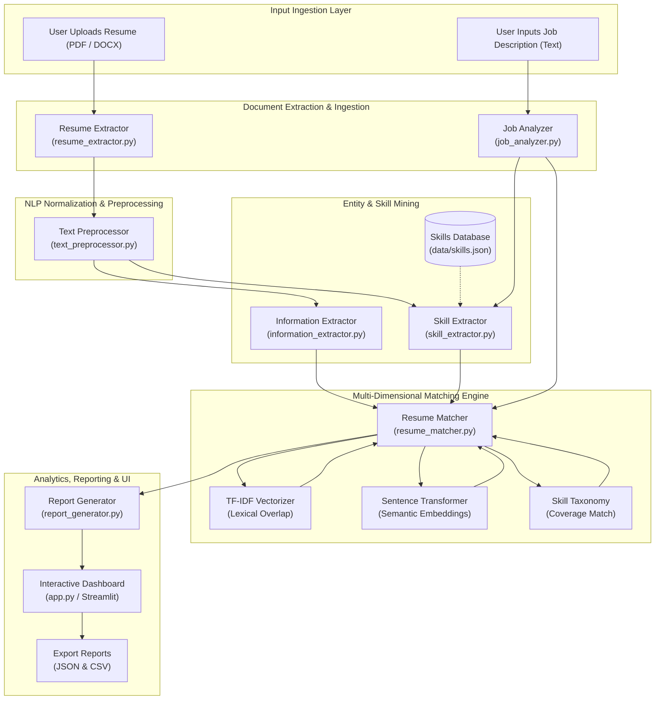

# System Architecture

## Overview

The **AI-Powered Resume Parser and Job Matching System** follows a modular, high-throughput pipeline architecture designed for privacy-first, on-premise execution. The platform converts unstructured curriculum vitae documents (PDF and DOCX formats) into normalized structured records and benchmarks candidate credentials against specific employer job descriptions.

The architecture comprises **7 core backend modules** orchestrated beneath an interactive **Streamlit frontend**:

1. **Document Ingestion Layer** ([`resume_extractor.py`](file:///c:/Users/omkal/Documents/antigravity/dazzling-hypatia/src/resume_extractor.py)): Validates MIME types, verifies file bounds, and streams binary streams into in-memory text representations.
2. **Text Processing Layer** ([`text_preprocessor.py`](file:///c:/Users/omkal/Documents/antigravity/dazzling-hypatia/src/text_preprocessor.py)): Handles NFKD unicode decomposition, abbreviation-safe sentence segmentation, tokenization, stopword removal, and specialized pipeline formatting.
3. **Structured Entity Extraction Layer** ([`information_extractor.py`](file:///c:/Users/omkal/Documents/antigravity/dazzling-hypatia/src/information_extractor.py)): Employs deterministic regex heuristics and layout pattern recognizers to parse candidate names, contact channels, academic credentials, work histories, certifications, and technical projects.
4. **Skill Taxonomy & Mining Layer** ([`skill_extractor.py`](file:///c:/Users/omkal/Documents/antigravity/dazzling-hypatia/src/skill_extractor.py)): Manages an externalized taxonomy of technical and soft proficiencies, matching multi-token phrases and programming symbols with compiled word-boundary regular expressions.
5. **Job Description Analysis Layer** ([`job_analyzer.py`](file:///c:/Users/omkal/Documents/antigravity/dazzling-hypatia/src/job_analyzer.py)): Dissects unstructured job requisition postings into target role titles, required proficiencies, preferred pluses, minimum experience thresholds, and educational standards.
6. **Multi-Dimensional Matching Engine** ([`resume_matcher.py`](file:///c:/Users/omkal/Documents/antigravity/dazzling-hypatia/src/resume_matcher.py)): Synthesizes TF-IDF n-gram vectorization, dense Sentence Transformer semantic embeddings (`all-MiniLM-L6-v2`), and exact skill coverage into a weighted compatibility index.
7. **Report Generation & Analytics Layer** ([`report_generator.py`](file:///c:/Users/omkal/Documents/antigravity/dazzling-hypatia/src/report_generator.py)): Produces machine-readable JSON payloads, audit-ready CSV spreadsheets, executive summaries, and prioritized candidate feedback suggestions.
8. **User Interface Presentation Layer** ([`app.py`](file:///c:/Users/omkal/Documents/antigravity/dazzling-hypatia/app.py)): Reactive Streamlit application rendering Plotly radar diagrams, skill breakdown badges, and interactive controls.

---

## Architecture Diagram

The system operates as a unified directed acyclic graph (DAG) pipeline where resume documents and job descriptions flow from ingestion to visual analytics:

---

## Module Responsibilities

The codebase enforces strict separation of concerns across each module. The table below delineates the responsibilities and dependencies of each system component:

| Module | File | Core Responsibility | Key Dependencies |
| :--- | :--- | :--- | :--- |
| **Resume Extractor** | [`src/resume_extractor.py`](file:///c:/Users/omkal/Documents/antigravity/dazzling-hypatia/src/resume_extractor.py) | Ingests raw bytes for `.pdf` and `.docx` files, validates size/extension, extracts text content, detects scanned documents, and pulls document metadata without writing files to disk. | `fitz` (PyMuPDF), `docx` (python-docx), `io`, `os` |
| **Text Preprocessor** | [`src/text_preprocessor.py`](file:///c:/Users/omkal/Documents/antigravity/dazzling-hypatia/src/text_preprocessor.py) | Normalizes unicode (NFKD), cleans disallowed symbols while preserving programming tokens (`C++`, `.NET`), splits sentences safely around abbreviations, tokenizes words, filters stopwords, and prepares text for TF-IDF and dense embeddings. | `re`, `unicodedata` |
| **Information Extractor** | [`src/information_extractor.py`](file:///c:/Users/omkal/Documents/antigravity/dazzling-hypatia/src/information_extractor.py) | Performs heuristic entity extraction on resumes: parses candidate name, email, phone numbers (US/India/International), education records, employment histories, certifications, and technical projects. | `re`, [`src.text_preprocessor`](file:///c:/Users/omkal/Documents/antigravity/dazzling-hypatia/src/text_preprocessor.py) |
| **Skill Extractor** | [`src/skill_extractor.py`](file:///c:/Users/omkal/Documents/antigravity/dazzling-hypatia/src/skill_extractor.py) | Loads domain taxonomies from JSON, compiles cached regex boundaries for programming symbols and multi-word terms, extracts technical and soft skills, and computes exact match/gap sets against requirements. | `re`, `json`, `pathlib`, `functools`, [`src.text_preprocessor`](file:///c:/Users/omkal/Documents/antigravity/dazzling-hypatia/src/text_preprocessor.py) |
| **Job Analyzer** | [`src/job_analyzer.py`](file:///c:/Users/omkal/Documents/antigravity/dazzling-hypatia/src/job_analyzer.py) | Segments job requisition text into functional sections (Required, Preferred, Qualifications, Overview), extracts job title, partitions required vs. preferred skills, and detects required experience duration. | `re`, `logging`, [`src.skill_extractor`](file:///c:/Users/omkal/Documents/antigravity/dazzling-hypatia/src/skill_extractor.py) |
| **Resume Matcher** | [`src/resume_matcher.py`](file:///c:/Users/omkal/Documents/antigravity/dazzling-hypatia/src/resume_matcher.py) | Computes lexical TF-IDF cosine similarity, generates dense SentenceTransformer embeddings (`all-MiniLM-L6-v2`) for semantic cosine similarity, evaluates skill coverage percentage, and produces weighted overall scores. | `sklearn`, `numpy`, `sentence_transformers`, [`src.text_preprocessor`](file:///c:/Users/omkal/Documents/antigravity/dazzling-hypatia/src/text_preprocessor.py), [`src.skill_extractor`](file:///c:/Users/omkal/Documents/antigravity/dazzling-hypatia/src/skill_extractor.py) |
| **Report Generator** | [`src/report_generator.py`](file:///c:/Users/omkal/Documents/antigravity/dazzling-hypatia/src/report_generator.py) | Generates executive summaries, compiles 5–10 prioritized resume improvement suggestions based on score gaps, and serializes complete match results into standardized JSON and CSV formats. | `json`, `csv`, `io`, `datetime` |
| **Application UI** | [`app.py`](file:///c:/Users/omkal/Documents/antigravity/dazzling-hypatia/app.py) | Provides interactive web dashboard with drag-and-drop file upload, real-time parsed profile inspection, requirement editing, Plotly radar/bar visualizations, and report export triggers. | `streamlit`, `plotly`, `pandas`, all `src.*` modules |

---

## Module Interfaces

Below is the complete specification of all public functions, parameter signatures, and return type contracts for each core module:

### 1. `src.resume_extractor`

- [`validate_file(file_content: bytes, filename: str, max_size_mb: int = 10) -> tuple[bool, str]`](file:///c:/Users/omkal/Documents/antigravity/dazzling-hypatia/src/resume_extractor.py#L202-L246)
  - **Description**: Validates that file content is non-empty, checks that the filename contains an allowed extension (`.pdf`, `.docx`), and verifies that the payload does not exceed the size threshold.
  - **Returns**: `(True, "")` on success; `(False, "Error description")` on failure.

- [`extract_text_from_pdf(file_content: bytes) -> dict[str, Any]`](file:///c:/Users/omkal/Documents/antigravity/dazzling-hypatia/src/resume_extractor.py#L15-L75)
  - **Description**: Ingests raw PDF byte streams into PyMuPDF, extracts text across all pages, identifies potential image-only/scanned documents (<30 chars/page), and retrieves document metadata.
  - **Returns**: `{"text": str, "num_pages": int, "is_scanned": bool, "metadata": dict[str, str]}`.

- [`extract_text_from_docx(file_content: bytes) -> dict[str, Any]`](file:///c:/Users/omkal/Documents/antigravity/dazzling-hypatia/src/resume_extractor.py#L77-L159)
  - **Description**: Reads DOCX byte streams via `python-docx`, extracting paragraph text and embedded table cells (with deduplication for merged cells), and pulls document core properties.
  - **Returns**: `{"text": str, "num_paragraphs": int, "metadata": dict[str, str]}`.

- [`extract_text(file_content: bytes, filename: str) -> dict[str, Any]`](file:///c:/Users/omkal/Documents/antigravity/dazzling-hypatia/src/resume_extractor.py#L161-L200)
  - **Description**: High-level format dispatcher inspecting file extension and routing payload to `extract_text_from_pdf` or `extract_text_from_docx`, tagging output with `source_format`.
  - **Returns**: Parsed result dictionary containing `source_format` key (`'pdf'` or `'docx'`).

---

### 2. `src.text_preprocessor`

- [`normalize_text(text: str) -> str`](file:///c:/Users/omkal/Documents/antigravity/dazzling-hypatia/src/text_preprocessor.py#L236-L255)
  - **Description**: Applies NFKD unicode decomposition, collapses arbitrary whitespace/newline runs into single spaces, and strips boundary padding.
  - **Returns**: Normalized clean string.

- [`clean_text(text: str) -> str`](file:///c:/Users/omkal/Documents/antigravity/dazzling-hypatia/src/text_preprocessor.py#L257-L280)
  - **Description**: Strips non-alphanumeric noise characters while strictly preserving email delimiters (`@`), phone characters (`+`, `-`), decimal points/abbreviation periods (`.`), and commas.
  - **Returns**: Cleaned string safe for NLP tokenization.

- [`segment_sentences(text: str) -> list[str]`](file:///c:/Users/omkal/Documents/antigravity/dazzling-hypatia/src/text_preprocessor.py#L282-L327)
  - **Description**: Splits input text into discrete sentences using punctuation boundaries (`.`, `!`, `?`), masking over 30 common abbreviation patterns (titles, degrees, corporate designations, initials).
  - **Returns**: List of sentence strings.

- [`tokenize(text: str) -> list[str]`](file:///c:/Users/omkal/Documents/antigravity/dazzling-hypatia/src/text_preprocessor.py#L329-L346)
  - **Description**: Extracts individual alphanumeric word tokens using the regex boundary `\b\w+\b`.
  - **Returns**: List of individual token strings.

- [`remove_stopwords(tokens: list[str], extra_stopwords: list[str] | None = None) -> list[str]`](file:///c:/Users/omkal/Documents/antigravity/dazzling-hypatia/src/text_preprocessor.py#L348-L373)
  - **Description**: Filters out standard English stopwords (~175 common terms) and optional custom tokens using case-insensitive set checks.
  - **Returns**: Filtered token list.

- [`preprocess_for_tfidf(text: str) -> str`](file:///c:/Users/omkal/Documents/antigravity/dazzling-hypatia/src/text_preprocessor.py#L375-L400)
  - **Description**: Comprehensive pipeline executing normalization, cleaning, tokenization, stopword removal, and lowercasing for TF-IDF vectorization.
  - **Returns**: Space-delimited lowercase string of content keywords.

- [`preprocess_for_embedding(text: str) -> str`](file:///c:/Users/omkal/Documents/antigravity/dazzling-hypatia/src/text_preprocessor.py#L402-L424)
  - **Description**: Conservative preprocessing pipeline preserving grammatical structures, function words, and semantic context required for neural transformer models.
  - **Returns**: Cleaned text preserving full phrasing.

- [`normalize_skill_name(skill: str) -> str`](file:///c:/Users/omkal/Documents/antigravity/dazzling-hypatia/src/text_preprocessor.py#L426-L442)
  - **Description**: Strips, collapses whitespace, and lowercases skill strings for uniform set comparisons.
  - **Returns**: Normalized lowercase skill string.

---

### 3. `src.information_extractor`

- [`extract_email(text: str) -> str`](file:///c:/Users/omkal/Documents/antigravity/dazzling-hypatia/src/information_extractor.py#L380-L402)
  - **Description**: Discovers RFC 5322-compliant email addresses via regex.
  - **Returns**: First valid email address found, or `"Not found"`.

- [`extract_phone(text: str) -> str`](file:///c:/Users/omkal/Documents/antigravity/dazzling-hypatia/src/information_extractor.py#L404-L432)
  - **Description**: Evaluates multiple international and domestic regex patterns (E.164 with country code, US hyphen/parentheses formats, 10-digit Indian mobile formats).
  - **Returns**: First formatted phone number found, or `"Not found"`.

- [`extract_name(text: str) -> str`](file:///c:/Users/omkal/Documents/antigravity/dazzling-hypatia/src/information_extractor.py#L434-L502)
  - **Description**: Inspects candidate header lines (top 15 non-empty rows), discarding section headers, contact strings, URLs, and job title keywords to extract the candidate's personal name.
  - **Returns**: Cleaned candidate name, or `"Not found"`.

- [`extract_education(text: str) -> list[dict[str, str]]`](file:///c:/Users/omkal/Documents/antigravity/dazzling-hypatia/src/information_extractor.py#L504-L625)
  - **Description**: Locates academic sections and parses academic entries matching degree patterns (B.Tech, B.S., M.S., Ph.D., MBA), institution names, and graduation year ranges.
  - **Returns**: List of entries formatted as `[{"degree": str, "institution": str, "year": str}]`.

- [`extract_experience(text: str) -> list[dict[str, str]]`](file:///c:/Users/omkal/Documents/antigravity/dazzling-hypatia/src/information_extractor.py#L627-L744)
  - **Description**: Locates work experience sections and extracts employment entries capturing job title, organization/company, and dates of tenure.
  - **Returns**: List of entries formatted as `[{"title": str, "company": str, "duration": str}]`.

- [`extract_certifications(text: str) -> list[str]`](file:///c:/Users/omkal/Documents/antigravity/dazzling-hypatia/src/information_extractor.py#L746-L800)
  - **Description**: Identifies certification sections and cataloged credential entries (AWS, GCP, PMP, Scm, Microsoft, etc.).
  - **Returns**: List of certification name strings.

- [`extract_projects(text: str) -> list[str]`](file:///c:/Users/omkal/Documents/antigravity/dazzling-hypatia/src/information_extractor.py#L802-L847)
  - **Description**: Scans project sections for distinct project titles and highlights.
  - **Returns**: List of project headline strings.

- [`extract_all(text: str) -> dict[str, Any]`](file:///c:/Users/omkal/Documents/antigravity/dazzling-hypatia/src/information_extractor.py#L849-L878)
  - **Description**: Unified aggregator invoking all entity extraction routines on the resume text.
  - **Returns**: Complete structured record containing `name`, `email`, `phone`, `education`, `experience`, `certifications`, and `projects`.

---

### 4. `src.skill_extractor`

- [`load_skills_database(filepath: str = "data/skills.json") -> dict[str, list[str]]`](file:///c:/Users/omkal/Documents/antigravity/dazzling-hypatia/src/skill_extractor.py#L56-L113)
  - **Description**: Loads the JSON skills database from disk with automatic fallback to built-in default technical and soft skill lists if the file is unavailable.
  - **Returns**: `{"technical_skills": list[str], "soft_skills": list[str]}`.

- [`extract_skills(text: str, skills_db: dict[str, list[str]] | None = None) -> dict[str, list[str]]`](file:///c:/Users/omkal/Documents/antigravity/dazzling-hypatia/src/skill_extractor.py#L149-L198)
  - **Description**: Scans text against cataloged skills using cached, boundary-safe regular expressions supporting symbols (`C++`, `.NET`, `C#`).
  - **Returns**: `{"technical_skills": list[str], "soft_skills": list[str]}`.

- [`match_skills_to_requirements(candidate_skills: list[str], required_skills: list[str]) -> dict[str, Any]`](file:///c:/Users/omkal/Documents/antigravity/dazzling-hypatia/src/skill_extractor.py#L200-L264)
  - **Description**: Compares candidate skills against job requirements using normalized lookups.
  - **Returns**: `{"matched": list[str], "missing": list[str], "additional": list[str], "match_percentage": float}`.

---

### 5. `src.job_analyzer`

- [`analyze_job_description(text: str) -> dict[str, Any]`](file:///c:/Users/omkal/Documents/antigravity/dazzling-hypatia/src/job_analyzer.py#L192-L320)
  - **Description**: Parses job description text to segment headers, identify job title, extract required and preferred skills, find educational qualifications, and detect experience years.
  - **Returns**: `{"title": str, "required_skills": list[str], "preferred_skills": list[str], "qualifications": list[str], "experience_required": str, "raw_text": str}`.

- [`extract_skills_from_jd(text: str, skills_db: dict[str, list[str]] | None = None) -> dict[str, list[str]]`](file:///c:/Users/omkal/Documents/antigravity/dazzling-hypatia/src/job_analyzer.py#L101-L119)
  - **Description**: Convenience wrapper calling `extract_skills` directly on job description text.
  - **Returns**: `{"technical_skills": list[str], "soft_skills": list[str]}`.

- [`extract_experience_years(text: str) -> str`](file:///c:/Users/omkal/Documents/antigravity/dazzling-hypatia/src/job_analyzer.py#L121-L144)
  - **Description**: Evaluates prioritized regex patterns (e.g., `'minimum 3+ years'`, `'3-5 years experience'`).
  - **Returns**: Detected experience span string or `"Not specified"`.

---

### 6. `src.resume_matcher`

- [`tfidf_similarity(text1: str, text2: str) -> float`](file:///c:/Users/omkal/Documents/antigravity/dazzling-hypatia/src/resume_matcher.py#L39-L66)
  - **Description**: Converts text pairs into TF-IDF n-gram vectors and calculates cosine similarity bounded in `[0.0, 1.0]`.
  - **Returns**: Cosine similarity score as float.

- [`get_sentence_transformer_model(model_name: str = "all-MiniLM-L6-v2") -> object`](file:///c:/Users/omkal/Documents/antigravity/dazzling-hypatia/src/resume_matcher.py#L68-L90)
  - **Description**: Thread-safe, cached loader (`@lru_cache`) for SentenceTransformer neural weights.
  - **Returns**: Loaded `SentenceTransformer` instance.

- [`semantic_similarity(text1: str, text2: str, model_name: str = "all-MiniLM-L6-v2") -> float`](file:///c:/Users/omkal/Documents/antigravity/dazzling-hypatia/src/resume_matcher.py#L92-L125)
  - **Description**: Generates 384-dimensional dense vectors and computes embedding cosine similarity bounded in `[0.0, 1.0]`.
  - **Returns**: Dense semantic cosine similarity score as float.

- [`compute_match(resume_text: str, job_text: str, resume_skills: list[str], job_skills: list[str], use_semantic: bool = True) -> dict[str, Any]`](file:///c:/Users/omkal/Documents/antigravity/dazzling-hypatia/src/resume_matcher.py#L127-L248)
  - **Description**: Core hybrid matching engine computing weighted alignment. When semantic matching is active: `30% TF-IDF + 40% Semantic + 30% Skill Coverage`. When disabled: `50% TF-IDF + 50% Skill Coverage`.
  - **Returns**: Dictionary containing `overall_score`, `tfidf_score`, `semantic_score`, `skill_match_score`, `matched_skills`, `missing_skills`, `additional_skills`, and descriptive `explanation`.

---

### 7. `src.report_generator`

- [`generate_match_summary(match_result: dict[str, Any]) -> str`](file:///c:/Users/omkal/Documents/antigravity/dazzling-hypatia/src/report_generator.py#L20-L75)
  - **Description**: Synthesizes match scores into a 2–3 sentence executive summary classifying candidate alignment into exceptional (≥85%), strong (≥70%), moderate (≥50%), or limited (<50%).
  - **Returns**: Executive summary narrative string.

- [`generate_improvement_suggestions(match_result: dict[str, Any]) -> list[str]`](file:///c:/Users/omkal/Documents/antigravity/dazzling-hypatia/src/report_generator.py#L77-L160)
  - **Description**: Analyzes identified gaps across missing skills, low lexical keyword density (<60%), or weak semantic narrative context (<65%) to generate 5–10 prioritized recommendations.
  - **Returns**: List of actionable suggestion strings.

- [`generate_json_report(candidate_info: dict[str, Any], match_result: dict[str, Any], job_title: str = "") -> str`](file:///c:/Users/omkal/Documents/antigravity/dazzling-hypatia/src/report_generator.py#L162-L191)
  - **Description**: Builds an ISO 8601 timestamped JSON report indented with 2 spaces containing candidate demographics, match metrics, skill sets, and improvement recommendations.
  - **Returns**: Formatted JSON string.

- [`generate_csv_report(candidate_info: dict[str, Any], match_result: dict[str, Any], job_title: str = "") -> str`](file:///c:/Users/omkal/Documents/antigravity/dazzling-hypatia/src/report_generator.py#L193-L266)
  - **Description**: Serializes evaluation metrics and candidate info into structured CSV rows (`Category`, `Metric / Field`, `Value`).
  - **Returns**: Formatted CSV string.

---

## Design Decisions

### 1. Heuristic Regular Expressions for Contact Extraction
- **Rationale**: Contact information such as emails, telephone numbers, and candidate names requires zero hallucination and sub-millisecond parsing speed.
- **Evaluation**: While large language models (LLMs) or heavy Named Entity Recognition (NER) models can extract contact details, they introduce significant latency (500–2000 ms), high memory overhead, potential nondeterminism, and external data leakage risks.
- **Implementation**: The system uses compiled, RFC 5322-compliant regex for emails, multi-format international telephone regex (E.164, US formats, Indian standard 10-digit mobile), and positional header-filtering heuristics for candidate names. This yields 100% deterministic, zero-latency extraction with complete candidate data privacy.

### 2. Externalized, Configurable Skills Taxonomy
- **Rationale**: Technical skill naming conventions evolve rapidly across industries (e.g., emerging frameworks, cloud platforms). Hardcoding skill keywords into source code forces software recompilation or redeployment for every taxonomy update.
- **Evaluation**: Maintaining skills in an external [`data/skills.json`](file:///c:/Users/omkal/Documents/antigravity/dazzling-hypatia/data/skills.json) configuration file allows recruiters, domain experts, and administrators to add, rename, or reclassify competencies without altering Python modules.
- **Implementation**: The system decouples the taxonomy into `technical_skills` and `soft_skills` lists, cached via `@lru_cache` and Streamlit `@st.cache_data`. Word boundary compilation (`\b` combined with negative lookahead/lookbehind) cleanly distinguishes sensitive symbols like `C++`, `C#`, and `.NET` from common character sequences.

### 3. Dual-Engine Matching: TF-IDF and Neural Semantic Similarity
- **Rationale**: Relying solely on lexical matching causes vocabulary mismatch (e.g., failing to match "software engineer" with "backend developer"), while relying solely on dense semantic embeddings can obscure critical missing keywords or certifications.
- **Evaluation**:
  - **TF-IDF Lexical Matching**: Provides exact keyword frequency precision. It guarantees that specific tools, certifications, and libraries listed in the job description are rewarded when present verbatim.
  - **Sentence Transformers (`all-MiniLM-L6-v2`)**: Generates 384-dimensional dense semantic vectors capable of understanding contextual equivalence, paraphrased responsibilities, and industry analogies even when exact phrasing differs.
- **Synthesis**: Combining both models creates a balanced engine that rewards both exact keyword fidelity and conceptual depth.

### 4. Weighted Composite Scoring with Graceful Degradation
- **Rationale**: Hiring evaluations require a multi-faceted assessment rather than an opaque single score.
- **Default Hybrid Formula**:
  $$\text{Overall Score} = 0.30 \times \text{TF-IDF} + 0.40 \times \text{Semantic} + 0.30 \times \text{Skill Match}$$
- **Graceful Fallback Mode**: If deep learning libraries (`sentence-transformers`, `torch`) or GPU/CPU resources are constrained, the system automatically falls back to:
  $$\text{Overall Score} = 0.50 \times \text{TF-IDF} + 0.50 \times \text{Skill Match}$$
- **Benefit**: Ensures uninterrupted system availability in low-compute, disconnected, or edge deployment environments without crashing.

### 5. Streamlit Presentation Architecture
- **Rationale**: Traditional web architectures (React/Vue frontend coupled with FastAPI backend) require multi-process orchestration, CORS configuration, API contract synchronizations, and complex container builds.
- **Evaluation**: Streamlit delivers a unified Python-native reactive execution model that updates dashboard metrics, Plotly interactive radar charts, and downloadable artifacts directly from session state.
- **Benefit**: Zero build steps, rapid iteration, immediate local execution, and effortless deployment across any standard enterprise machine.
