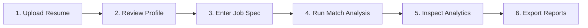

# User Manual

## Introduction

The **AI-Powered Resume Parser and Job Matching System** is an interactive, privacy-first recruitment analytics platform. Designed for recruiters, hiring managers, and job candidates, the system automates resume ingestion, extracts structured professional profiles from unstructured PDF and Word documents, and objectively evaluates candidate qualifications against target job descriptions.

By combining deterministic text extraction heuristics, configurable domain taxonomies, and a hybrid multi-dimensional matching engine (TF-IDF lexical frequency + Sentence Transformer semantic embeddings), the application delivers instantaneous compatibility assessments, detailed skill gap breakdowns, and actionable profile optimization guidance through a clean, intuitive web dashboard.

---

## System Requirements

Before installing and running the application, ensure your workstation meets the following minimum specifications:

| Component | Minimum Specification | Recommended Specification |
| :--- | :--- | :--- |
| **Operating System** | Windows 10/11, macOS 12+, or Linux (Ubuntu 20.04+) | Windows 11 / Ubuntu 22.04 LTS |
| **Python** | Python 3.11.0 or higher | Python 3.11.x (64-bit) |
| **Memory (RAM)** | 4 GB RAM minimum | 8 GB RAM or higher (for embedding generation) |
| **Disk Space** | 2 GB free disk space | 4 GB free disk space (dependencies + PyTorch models) |
| **Web Browser** | Modern standards-compliant browser | Google Chrome, Mozilla Firefox, Microsoft Edge |
| **Internet Access** | Required only for initial installation & model download | Offline capable after first model cache |

---

## Installation

Follow these step-by-step instructions to configure your local development environment:

### Step 1: Clone or Navigate to the Project

Open your command terminal (PowerShell on Windows, Terminal on macOS/Linux) and navigate to the project directory:

```bash
cd c:\Users\omkal\Documents\antigravity\dazzling-hypatia
```

### Step 2: Create and Activate a Virtual Environment

Isolate application dependencies by creating a dedicated Python 3.11 virtual environment:

- **Windows (PowerShell)**:
  ```powershell
  python -m venv venv
  .\venv\Scripts\Activate.ps1
  ```
  *(Note: If script execution is restricted in PowerShell, run `Set-ExecutionPolicy -Scope Process -ExecutionPolicy Bypass` prior to activation).*

- **Windows (Command Prompt)**:
  ```cmd
  python -m venv venv
  venv\Scripts\activate.bat
  ```

- **Linux / macOS**:
  ```bash
  python3.11 -m venv venv
  source venv/bin/activate
  ```

### Step 3: Upgrade Package Installer and Install Dependencies

Install all pinned production libraries specified in [`requirements.txt`](file:///c:/Users/omkal/Documents/antigravity/dazzling-hypatia/requirements.txt):

```bash
python -m pip install --upgrade pip
pip install -r requirements.txt
```

### Step 4: Download NLP Linguistic Corpora (Optional / Recommended)

To ensure tokenizers and linguistic stopword sets are available locally, execute:

```bash
python -c "import nltk; nltk.download('punkt'); nltk.download('stopwords')"
```

---

## Starting the Application

Launch the Streamlit web server directly from the root project directory:

```bash
streamlit run app.py
```

### Expected Output

Upon successful execution, Streamlit displays startup details in your terminal:

```text
  You can now view your Streamlit app in your browser.

  Local URL: http://localhost:8501
  Network URL: http://192.168.1.100:8501
```

The application automatically opens in your default web browser. If it does not open automatically, copy and paste `http://localhost:8501` into your browser address bar.

> [!TIP]
> **Custom Port Configuration**: To run on an alternative port (e.g., port 8080), specify:
> ```bash
> streamlit run app.py --server.port 8080 --server.address 127.0.0.1
> ```

To stop the web server, press `Ctrl + C` in your command terminal.

---

## Using the Application

The user interface follows a clear, progressive step-by-step workflow:



---

### Step 1: Upload Resume

1. In the **"📄 Resume Input"** card on the main dashboard, you can either:
   - Click **"Browse files"** to select a candidate resume from your filesystem.
   - Drag and drop a `.pdf` or `.docx` file into the upload zone.
   - Click **"Load Sample Resume"** to instantly test the system with a pre-configured senior developer profile.
2. **File Validation**:
   - The file validation layer ([`validate_file`](file:///c:/Users/omkal/Documents/antigravity/dazzling-hypatia/src/resume_extractor.py#L202-L246)) validates that the document is non-empty, matches permitted extensions (`.pdf`, `.docx`), and is under the 10 MB size limit.
   - If an image-only or scanned PDF is detected (<30 characters per page), a warning banner alerts you that the file may require optical character recognition (OCR).

---

### Step 2: Review Parsed Information

Once uploaded, the document is processed in-memory. Expand or review the **"👤 Parsed Candidate Profile"** section:

1. **Candidate Demographics**:
   - **Candidate Name**: Extracted from header lines via [`extract_name`](file:///c:/Users/omkal/Documents/antigravity/dazzling-hypatia/src/information_extractor.py#L434-L502).
   - **Email Address**: Extracted via [`extract_email`](file:///c:/Users/omkal/Documents/antigravity/dazzling-hypatia/src/information_extractor.py#L380-L402).
   - **Phone Number**: Extracted via [`extract_phone`](file:///c:/Users/omkal/Documents/antigravity/dazzling-hypatia/src/information_extractor.py#L404-L432).
2. **Structured Sections**:
   - **Education**: Lists detected academic degrees, institutions, and graduation spans.
   - **Work Experience**: Shows role titles, employer organizations, and duration tenures.
   - **Skills Detected**:
     - *Technical Skills* rendered in light blue badges (e.g., `Python`, `Docker`, `PostgreSQL`).
     - *Soft Skills* rendered in light purple badges (e.g., `Leadership`, `Collaboration`).
   - **Certifications**: Industry accreditations identified in the resume (e.g., `AWS Certified Solutions Architect`).
   - **Key Projects**: Technical projects and software implementations extracted from project headers.

---

### Step 3: Enter Job Description

1. In the **"💼 Job Description Input"** card:
   - Paste the target job posting into the text area.
   - Or click **"Load Sample JD"** to populate the input with a pre-configured backend developer requisition.
2. **Automated Requisition Parsing**:
   - The system executes [`analyze_job_description`](file:///c:/Users/omkal/Documents/antigravity/dazzling-hypatia/src/job_analyzer.py#L192-L320) to identify:
     - Target Job Title (e.g., *"Senior Backend Engineer"*).
     - Required Experience Span (e.g., *"3+ years of experience"*).
     - Minimum Qualifications & Degrees.
     - Extracted Required Skills vs. Preferred Skills.
3. **Interactive Skill Customization**:
   - The identified required skills appear in an editable text box. You can manually add, edit, or delete skills before running the match engine.

---

### Step 4: Analyze Match

1. **Configure Sidebar Settings**:
   - **Enable Semantic Matching**: Toggle semantic scoring on or off. When enabled, the neural Sentence Transformer model (`all-MiniLM-L6-v2`) evaluates deep conceptual similarity. When disabled, the engine relies strictly on lexical TF-IDF overlap and skill coverage.
   - Review the active scoring weights displayed in the sidebar.
2. **Trigger Compatibility Engine**:
   - Click the primary **"🚀 Calculate Compatibility Score"** button.
   - The system calls [`compute_match`](file:///c:/Users/omkal/Documents/antigravity/dazzling-hypatia/src/resume_matcher.py#L127-L248) to synthesize lexical, semantic, and skill metrics.

---

### Step 5: Review Results

The match evaluation appears immediately in the **"⚡ Match Analysis"** card:

1. **Overall Match Score Banner**:
   - Large formatted percentage display (e.g., `82.4%`).
   - Progress bar and colored alignment tier:
     - 🟢 **Strong Alignment** (Score ≥ 70%): Highly qualified candidate profile.
     - 🟡 **Moderate Alignment** (40% ≤ Score < 70%): Partial fit with skill or narrative gaps.
     - 🔴 **Low Alignment** (Score < 40%): Substantial divergence from core requirements.
2. **Component Metric Cards**:
   - **🔤 TF-IDF Score**: Exact vocabulary and technical keyword frequency overlap.
   - **🧠 Semantic Score**: Dense contextual and semantic similarity from Sentence Transformers.
   - **🎯 Skill Match Score**: Deterministic coverage percentage of required competencies.
3. **Interactive Visualizations**:
   - **Plotly Radar Chart**: Visualizes the balanced profile triangle across Lexical, Semantic, and Skill dimensions.
   - **Plotly Horizontal Bar Chart**: Compares quantities of Matched, Missing, and Additional skills.
4. **Skills Alignment Breakdown**:
   - **Matched Skills**: Confirmed required skills possessed by the candidate (green `✓` badges).
   - **Missing Skills**: Crucial job requirements absent from the candidate profile (red `✗` badges).
   - **Additional Skills**: Supplemental proficiencies offered by the candidate (blue `+` badges).
5. **Executive Summary & Explanations**:
   - 2–3 sentence executive summary explaining fit and interview readiness via [`generate_match_summary`](file:///c:/Users/omkal/Documents/antigravity/dazzling-hypatia/src/report_generator.py#L20-L75).
   - Expandable detailed explanation showing formula components and counts.
6. **💡 Improvement Suggestions**:
   - 5 to 10 prioritized, actionable recommendations generated by [`generate_improvement_suggestions`](file:///c:/Users/omkal/Documents/antigravity/dazzling-hypatia/src/report_generator.py#L77-L160) targeting missing skills, keyword alignment, and STAR project formatting.

---

### Step 6: Download Reports

In the **"📥 Report Export"** section, generate and download structured records for your hiring pipeline or audit archive:

- **Download JSON Report** (`candidate_report.json`): Complete structured payload with ISO 8601 timestamp, candidate info, individual scores, skill arrays, and suggestions.
- **Download CSV Report** (`candidate_report.csv`): Tabular record organized by `Category`, `Metric / Field`, and `Value` for easy import into Excel, Google Sheets, or applicant tracking systems (ATS).

---

## Troubleshooting

### 1. Model Download Issues
- **Symptom**: Application hangs or logs errors when downloading `sentence-transformers/all-MiniLM-L6-v2` (`HTTPSConnectionPool`, `ConnectTimeoutError`).
- **Solution**:
  - The model requires an initial download (~90 MB) from Hugging Face Hub. Ensure your internet connection is active during first launch.
  - If operating behind a corporate proxy or firewall, configure the proxy in your environment:
    ```bash
    set HTTP_PROXY=http://proxy.corporate.com:8080
    set HTTPS_PROXY=http://proxy.corporate.com:8080
    ```
  - **Offline Fallback**: Disable the "Enable Semantic Matching" toggle in the left sidebar. The system immediately falls back to pure TF-IDF + Skill Matching without requesting any external downloads.

### 2. Module Import Errors
- **Symptom**: `ModuleNotFoundError: No module named 'fitz'` or `ModuleNotFoundError: No module named 'src'`.
- **Solution**:
  - Verify your virtual environment is active (your prompt should show `(venv)`).
  - Note that PyMuPDF is imported via `import fitz`. Ensure you ran `pip install -r requirements.txt`. If needed, manually reinstall: `pip install PyMuPDF==1.24.10`.
  - Always launch the application from the project root directory: `cd dazzling-hypatia && streamlit run app.py`.

### 3. Empty Extraction on Uploaded PDF
- **Symptom**: Candidate name, education, or skills show `"Not found"` or empty lists.
- **Solution**:
  - Check if the PDF is a scanned image or photograph. The system will display the banner: *"Scanned or image-based document detected"*.
  - Scanned PDFs lack raw text layers and require OCR pre-processing. Re-save or export the resume from Word or Google Docs using **"Save as PDF"** (vector text format) rather than scanning a printed page.
  - Verify that the PDF is not encrypted or password-protected.

### 4. High Latency or Slow Performance
- **Symptom**: Analysis takes 5–10 seconds per calculation.
- **Solution**:
  - Dense embedding generation on CPU requires moderate compute. Subsequent runs are significantly faster due to `@st.cache_resource` and `@functools.lru_cache`.
  - For instantaneous sub-second calculations on lower-powered hardware, toggle off **"Enable Semantic Matching"** in the sidebar.

---

## FAQ

### 1. What file formats and size limits are supported?
The system supports Microsoft Word documents (`.docx`) and Adobe Portable Document Format files (`.pdf`). File uploads are bounded by default to a maximum limit of **10 MB** to safeguard system memory. Files exceeding this limit are cleanly rejected by the validation layer.

### 2. Is candidate data transmitted to external cloud APIs or third parties?
**No.** The entire parsing, extraction, and scoring pipeline runs strictly locally in-memory on your machine. No candidate resumes, personal contact details, or job requisition texts are ever uploaded to cloud endpoints or third-party AI services.

### 3. How is the overall compatibility score calculated?
When semantic matching is enabled, the score is calculated as:
$$\text{Overall Score} = (0.30 \times \text{TF-IDF Score}) + (0.40 \times \text{Semantic Score}) + (0.30 \times \text{Skill Match Score})$$
When semantic matching is disabled, the system dynamically reallocates weights to:
$$\text{Overall Score} = (0.50 \times \text{TF-IDF Score}) + (0.50 \times \text{Skill Match Score})$$

### 4. What happens if Sentence Transformers or PyTorch cannot run on my computer?
The system features an automated fault-tolerant fallback mechanism. If `sentence-transformers` is unavailable or throws an exception, the matching engine automatically catches the error, sets `semantic_score = None`, and computes the overall score using the 50/50 lexical and skill formula without interrupting the user experience.

### 5. Can I customize or expand the technical skills database?
**Yes.** All recognized technical competencies and soft skills are cataloged in [`data/skills.json`](file:///c:/Users/omkal/Documents/antigravity/dazzling-hypatia/data/skills.json). You can open this file in any text editor and append new skills to either the `"technical_skills"` or `"soft_skills"` arrays. The changes are loaded on next run or when the application restarts.
